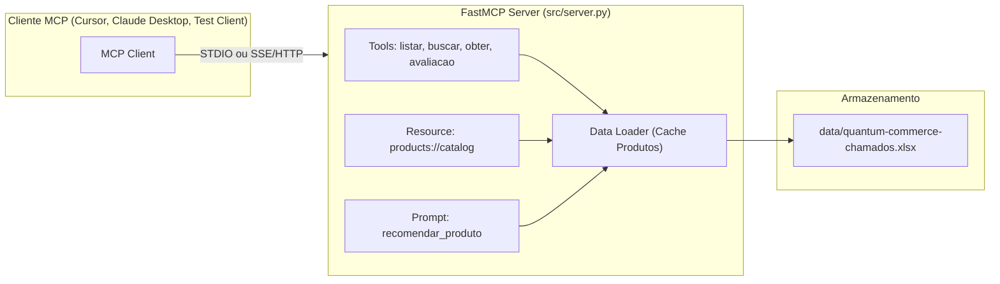

# Plano de Implementação: Servidor MCP com FastMCP para Quantum Commerce

Este documento detalha o plano de criação do servidor MCP (Model Context Protocol) utilizando **FastMCP**, integrando os dados da planilha `data/quantum-commerce-chamados.xlsx` com suporte a execução via **STDIO** e **SSE**, incluindo ferramentas, recursos e prompts exigidos.

A raiz do projeto é: `intergration-arch-final-project/`.

---

## 1. Escolha de Ambiente: Windows vs WSL

Conforme a avaliação entre **Windows nativo** e **WSL**:

| Critério | Windows Nativo (Recomendado) | WSL (Linux Subsystem) |
| :--- | :--- | :--- |
| **Acesso aos Arquivos** | Acesso direto ao caminho `intergration-arch-final-project/data/quantum-commerce-chamados.xlsx` sem conversão de caminho (`/mnt/c/...`). | Requer tradução de caminhos entre Windows e Linux. |
| **Integração com Ferramentas MCP** | Clientes MCP rodando no Windows (como Claude Desktop, Antigravity, cursores locais) conectam diretamente via STDIO chamando `python server.py`. | Clientes MCP no Windows precisariam invocar `wsl -e python3 ...`, adicionando complexidade de processos e pipes. |
| **Transporte SSE** | Execução de servidor HTTP local (`127.0.0.1:8000`) sem bloqueio de rede entre host e VM WSL. | Port forwarding ou localhost tunneling do WSL pode exigir configurações de firewall. |
| **Estado Atual** | Requer instalação do Python no Windows (via winget ou instalador oficial) ou uv. | WSL já está disponível no sistema. |

> [!IMPORTANT]
> **Decisão Recomendada**: Utilizar **Windows nativo**. Para isso, faremos a instalação/configuração do Python 3.12 no Windows nativo (ou no WSL caso seja da sua preferência).

---

## 2. Análise dos Dados (`data/quantum-commerce-chamados.xlsx`)

Inspecionamos a planilha localizada em `intergration-arch-final-project/data/quantum-commerce-chamados.xlsx` e identificamos as seguintes colunas essenciais:
- `id_produto`: Ex: `P001`, `P002`, `P003`, `P031`... (33 produtos distintos mapeados a partir dos chamados)
- `nome_produto`: Ex: `Quebra-cabeça 1000 peças Paisagem Alpina`
- `categoria_produto`: Ex: `brinquedo`, `outros`, `maquiagem`, `game`, `livro`
- `preco`: Preço numérico (ex: `81.53`, `176.83`)
- `avaliacao_produto`: Nota média de avaliação (ex: `3.6`, `4.2`)
- `descricao_produto`: Descrição detalhada do produto

---

## 3. Arquitetura e Estrutura de Pastas

A estrutura sob a raiz `intergration-arch-final-project/`:

```
intergration-arch-final-project/
├── data/
│   └── quantum-commerce-chamados.xlsx
├── docs/
│   └── plano_servidor_fastmcp.md   # Documentação e plano de implementação
├── example/
│   └── Aula_3_Servidor_MCP_Simples.ipynb
├── src/
│   ├── __init__.py
│   ├── data_loader.py             # Leitura, limpeza e cache em memória dos produtos
│   └── server.py                  # Servidor FastMCP com Tools, Resource, Prompt e CLI STDIO/SSE
├── tests/
│   └── test_client.py             # Teste cliente automatizado via MCP Client / FastMCP API
├── requirements.txt               # fastmcp, pandas, openpyxl, uvicorn
└── README.md                      # Instruções de instalação e execução (STDIO / SSE)
```

### Diagrama de Comunicação MCP



---

## 4. Componentes Obrigatórios do MCP

### 4.1 Tools (Mínimo de 4 ferramentas)

1. **`listar_produtos_por_categoria(categoria: str) -> list[dict]`**
   - Filtra produtos que pertencem à categoria informada (busca insensível a maiúsculas/minúsculas).
   - Se nenhuma categoria for informada ou categoria for vazia, lista todas as categorias existentes com a contagem de produtos.

2. **`obter_produto_por_id(id_produto: str) -> dict`**
   - Dado um ID (ex: `P003`), retorna os dados: `id_produto`, `nome`, `categoria`, `preco` e `descricao`.
   - Retorna mensagem clara de erro caso o ID não seja encontrado.

3. **`buscar_produtos_por_nome(termo: str) -> list[dict]`**
   - Realiza busca textual no nome e na descrição do produto (ex: busca por `"mochila"` ou `"cafeteira"`).

4. **`obter_avaliacao_produto(id_ou_nome: str) -> dict`**
   - Dado o ID ou nome do produto, retorna o nome, ID, nota de avaliação (`avaliacao_produto`) e classificação textual (ex: Crítica < 3.0, Regular < 4.0, Excelente >= 4.0).

### 4.2 Resource (Mínimo de 1 recurso)

- **`products://catalog`** (e `products://categories`):
  - Retorna o catálogo completo de produtos em formato JSON estruturado com metadados e estatísticas (total de produtos, lista completa com preços e notas).
  - Permite aos LLMs inspecionarem o contexto integral do catálogo de uma só vez quando necessário.

### 4.3 Prompt (Mínimo de 1 prompt)

- **`recomendar_produto(categoria: str, orcamento_maximo: float | None = None, foco_avaliacao: bool = True)`**
  - Gera um prompt estruturado para o assistente recomendando as melhores opções dentro da base com base em critérios de categoria, orçamento e avaliação.

### 4.4 Transportes Suportados (STDIO e SSE)

O arquivo `src/server.py` suportará execução configurável via CLI:

```bash
# Modo STDIO (padrão para clientes desktop locais como Claude Desktop ou Cursor)
python src/server.py --transport stdio

# Modo SSE (servidor HTTP com Server-Sent Events na porta configurada)
python src/server.py --transport sse --port 8000
```

---

## 5. Plano de Verificação

### Testes Automatizados e Cliente MCP
Criaremos o script `tests/test_client.py` que executa chamadas reais no servidor FastMCP:
1. Validação do carregamento de dados da planilha `data/quantum-commerce-chamados.xlsx` (33 produtos).
2. Chamada de cada uma das 4 tools com asserções de conteúdo.
3. Leitura e integridade do resource `products://catalog`.
4. Renderização do prompt `recomendar_produto`.
5. Validação de inicialização no modo STDIO e inicialização com flag `--transport sse`.

